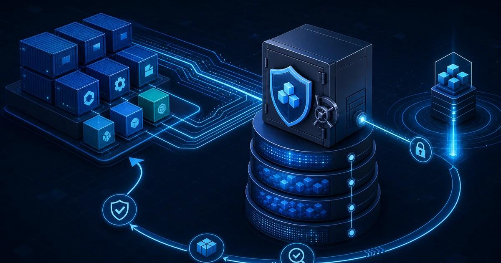

# Backup-Manager

Синхронизация локальных каталогов с удалённым SMB-сервером

[](LICENSE)
[](package.json)


[](https://boosty.to/backup_manager)



**Backup Manager** — локальное веб-приложение для настройки и управления синхронизацией локальных каталогов с ресурсами SMB/CIFS. Приложение объединяет веб-интерфейс, локальный API и фоновое выполнение заданий на Linux.

Вместо ручного запуска команд администратор настраивает источники, параметры SMB и расписание в одном интерфейсе, запускает синхронизацию по запросу и просматривает историю операций.

## Возможности

- **Задания синхронизации.** Выбор исходного каталога через встроенный браузер файловой системы (начальная папка `/home`), создание, редактирование, включение, остановка и удаление заданий; запуск вручную с отображением прогресса.
- **Расписание.** Автоматический запуск заданий по расписанию.
- **SMB/CIFS.** Сохранение параметров сервера и общего ресурса, проверка подключения и автоматическое монтирование при выполнении задания.
- **Копирование через `rsync`.** Символические ссылки, устройства и специальные файлы, вложенные файловые системы, скрытые файлы и каталоги (маска `.*`), каталог перенаправленных дисков ThinLinc `thinclient_drives`, а также распространённые временные файлы (`*.tmp`, `*.temp`, файлы подкачки редакторов, частичные загрузки и временные файлы офисных приложений) пропускаются. Настраиваются сжатие, ограничение пропускной способности, повторные попытки и удаление файлов, отсутствующих в источнике.
- **Мониторинг.** Просмотр состояния заданий и журнала событий в веб-интерфейсе.
- **Проверка изменений.** Запуск `rsync --dry-run` с перечнем файлов, которые будут удалены; проверка не изменяет данные.
- **Архивы и восстановление.** Необязательное создание датированных `.tar.gz` архивов после синхронизации с настройкой количества хранимых копий. Раздел восстановления показывает хранилище этой машины и позволяет скачивать файлы или восстанавливать выбранный каталог/архив в пустую локальную папку.
- **Ярлык приложения.** Linux-пакеты устанавливают ярлык Backup Manager в меню приложений.
- **Локальное хранение.** Настройки, задания и журнал сохраняются backend на компьютере, где запущен сервис.

Опция `--inplace` в настройках rsync отключает временные файлы и последующее переименование, **но при прерывании передачи файл в копии может остаться неполным**.
Маски исключения настраиваются в разделе «Настройки»: стандартные можно удалить или изменить, а свои — добавить отдельными строками. Файлы блокировок Р-7 Офис `.~lock.*` и `~$*` входят в список по умолчанию.

Задания выполняются последовательно. Каждый набор данных синхронизируется в отдельный каталог внутри настроенной точки монтирования. Удаление файлов назначения, отсутствующих в источнике, выключено по умолчанию; при необходимости удаление можно отложить до конца передачи через `--delete-delay`. Архивы хранятся отдельно в каталоге `имя-хоста/archives`.

Если файлы в копии меняются во время создания архива, временный архив удаляется, предыдущие архивы сохраняются, а в журнал записывается предупреждение с путями замеченных файлов. Синхронизация при этом считается успешной. Архиватор читает каталог последовательно, поэтому ZIP вместо TAR.GZ сам по себе не предотвращает изменения файлов во время чтения; для согласованного архива нужна неизменяемая копия или снимок файловой системы.

При резервировании домашнего каталога учитывайте, что все скрытые данные, включая `.config`, `.ssh` и `.local`, исключаются по умолчанию. Изменяемые приложения могут создавать несогласованные копии баз данных и профилей; для согласованной копии их следует закрыть перед запуском. Вложенные точки монтирования резервируются отдельными заданиями.

## Как это работает

1. В веб-интерфейсе задаются каталог-источник, параметры SMB/CIFS и расписание.
2. Backend сохраняет конфигурацию локально и при запуске задания проверяет и монтирует сетевой ресурс.
3. `rsync` синхронизирует данные в каталог задания на ресурсе. Данные хранятся в каталогах `имя-хоста/имя-задания`; при включённой настройке архивы создаются в `имя-хоста/archives`.
4. Результат выполнения и диагностические сообщения отображаются в журнале.

React-интерфейс обслуживается Nginx, который передаёт запросы API локальному Node.js backend. API и Nginx привязаны к loopback-интерфейсу; приложение рассчитано на работу на том же компьютере, где выполняется синхронизация.

## Технологии

- React, TypeScript и Vite — веб-интерфейс.
- Node.js — локальный API, хранение данных, расписание и очередь заданий.
- `rsync`, `smbclient` и CIFS mount utilities — проверка SMB и копирование на Linux.
- systemd и Nginx — запуск и публикация локального интерфейса в Linux-пакетах.

## Требования и поддержка платформ

Для проверки SMB и выполнения копирования необходим Linux с установленными `rsync`, `smbclient` и CIFS mount utilities. Для монтирования ресурса нужны соответствующие системные привилегии; установленный API-сервис запускается от root.

## Сборка пакетов Linux

Для Linux подготовлены два формата пакетов. Сборку выполняйте в соответствующей Linux-среде; до использования в рабочей системе проверьте пакет на целевом дистрибутиве.

### Debian/Ubuntu/Астра Линукс (`.deb`)

Установите Node.js 22+, npm и `dpkg-deb`, затем из корня репозитория соберите пакет:

```bash
bash ./deb-build/build-deb.sh
```

Пакет появится в `dist/packages/backup-manager_<версия>_all.deb`.

Выполните установку

```bash
sudo apt install ./dist/packages/backup-manager_<версия>_all.deb
```

Выполните первоначальную настройку:

```bash
sudo /usr/share/backup-manager/scripts/setup.sh
```

Команды выполняются из корня репозитория. Сценарий настройки создаёт секреты и выводит пароль пользователя `backup` один раз. После этого откройте `http://localhost:8080` на компьютере, где установлен сервис. При `apt remove` локальное состояние в `/var/lib/backup-manager` сохраняется; даже `apt purge` не удаляет этот каталог автоматически. Подробности о сборке, установке, диагностике и удалении — в [`deb-build/README.md`](./deb-build/README.md).

### РЕД ОС 7.3/8 (RPM)

Соберите RPM в Linux-среде с Node.js 22+, npm и `rpmbuild`:

```bash
bash ./rpm-build/build-rpm.sh
```

После установки RPM запустите сценарий первоначальной настройки от root. Он создаст пароль приложения и выведет его один раз. Подробные требования и инструкции по установке, обновлению, диагностике и удалению находятся в [`rpm-build/README.md`](./rpm-build/README.md).

### Общие замечания

В установленных вариантах Nginx и API доступны только на loopback; веб-интерфейс предназначен для локального использования. Для проверки SMB и запуска синхронизации необходимы Linux, systemd, `rsync`, `smbclient` и CIFS mount utilities. Установленные API-сервисы запускаются от root, чтобы монтировать сетевые ресурсы.

## Данные и безопасность

- Backend принимает API-запросы только через loopback. В установленном варианте доступ защищён паролем приложения; dev-режим такой авторизации не включает.
- Пароль SMB хранится локально и не возвращается веб-интерфейсу через API. Доступ к файлам хранилища ограничен системными правами.
- Локальное хранилище **не шифруется**. Защищайте компьютер и каталог данных средствами операционной системы и не предоставляйте к ним доступ посторонним.
- Приложение предназначено для локального администрирования, а не для публикации в интернете или совместного доступа нескольких пользователей.
- Опция `--delete` при синхронизации выключена по умолчанию. При её включении файлы в копии, отсутствующие в источнике, удаляются.

## Структура проекта

- [`src/`](./src/) — React-интерфейс и клиент API.
- [`server/index.js`](./server/index.js) — backend, локальное хранилище, расписание и выполнение заданий.
- [`server/index.test.js`](./server/index.test.js) — тесты API.
- [`rpm-build/`](./rpm-build/) — RPM-сборка и интеграция с systemd/Nginx.
- [`rpm-build/README.md`](./rpm-build/README.md) — подробная инструкция по сборке и установке RPM.
- [`deb-build/`](./deb-build/) — Debian-пакет и сценарии для Debian/Ubuntu.
- [`deb-build/README.md`](./deb-build/README.md) — подробная инструкция по сборке и установке Debian-пакета.

## Скриншоты


[Автору на кофе с печенькой](https://boosty.to/backup_manager/donate)
